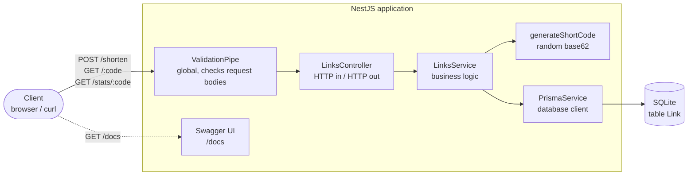

# URL Shortener API

A small REST API that shortens URLs, in the spirit of bit.ly.

- **Stack:** Node.js, TypeScript, [NestJS](https://nestjs.com/), [Prisma](https://www.prisma.io/), SQLite
- **Endpoints:** `POST /shorten`, `GET /:code`, `GET /stats/:code`
- **Interactive docs:** Swagger UI at `/docs`, OpenAPI JSON at `/docs-json`
- **Zero external services:** the database is a single SQLite file, so the project runs with Node alone (or with Docker)

## Requirements

Either of:

- **Node.js 20 or newer** (developed and tested on Node 24) with npm
- **Docker** with the Compose plugin

## Run locally

```bash
git clone <this repository> url-shortener
cd url-shortener

npm install                 # installs dependencies and generates the Prisma client
cp .env.example .env        # optional: the defaults match the example file (Windows cmd: copy)
npm run prisma:migrate      # creates ./dev.db and applies the migrations
npm run start               # API is up at http://localhost:3000
```

Other useful commands:

```bash
npm run start:dev           # watch mode with auto-reload
npm run build && npm run start:prod   # compiled production build
npm run prisma:studio       # browse the database in Prisma Studio
```

Works on Linux, macOS and Windows. The SQLite driver ships prebuilt binaries for all three, so no compiler is needed.

## Run with Docker

```bash
docker compose up --build   # API is up at http://localhost:3000
```

Migrations are applied automatically when the container starts. The SQLite file is stored in a named volume (`db-data`), so data survives restarts and rebuilds.

## Configuration

All settings come from environment variables (or a `.env` file, see [.env.example](.env.example)). Every variable has a working default.

| Variable       | Default                 | Purpose                                                        |
| -------------- | ----------------------- | -------------------------------------------------------------- |
| `PORT`         | `3000`                  | Port the HTTP server listens on                                |
| `BASE_URL`     | `http://localhost:3000` | Public base URL used to build `shortUrl` in `POST /shorten`    |
| `DATABASE_URL` | `file:./dev.db`         | SQLite file location, relative to the project root             |

## API documentation (Swagger)

Once the service is running, open **http://localhost:3000/docs** for interactive Swagger UI, or fetch the raw OpenAPI 3 document at `http://localhost:3000/docs-json` (importable into Postman or Insomnia).

Swagger UI's "Try it out" on `GET /{code}` makes the browser follow the redirect with `fetch`, so it may show a CORS or network error even though the redirect worked. Open the short URL in a browser tab or use `curl -i` to see the `302` itself.

## How it works



Sequence diagrams for each endpoint, the data model and the startup flow are in [docs/architecture.md](docs/architecture.md). GitHub renders them as images.

## API

All request and response bodies are JSON. Errors always have the same shape:

```json
{ "statusCode": 400, "error": "Bad Request", "message": "..." }
```

For validation errors `message` is an array with one entry per invalid field.

### `POST /shorten`

Creates a short link.

```bash
curl -X POST http://localhost:3000/shorten \
  -H 'Content-Type: application/json' \
  -d '{"url": "https://example.com/some/very/long/path?with=query"}'
```

`201 Created`

```json
{
  "code": "aZ3kQ9x",
  "shortUrl": "http://localhost:3000/aZ3kQ9x",
  "originalUrl": "https://example.com/some/very/long/path?with=query"
}
```

Validation rules for `url`: required, string, at most 2048 characters, a valid absolute URL with an `http` or `https` scheme. Unknown fields in the body are rejected.

| Status | When                                        | `message`                                     |
| ------ | ------------------------------------------- | --------------------------------------------- |
| `400`  | `url` missing or not a string               | `["url is required and must be a string"]`    |
| `400`  | `url` is not an `http(s)` URL               | `["url must be a valid http(s) URL"]`         |
| `400`  | `url` longer than 2048 characters           | `["url must be at most 2048 characters long"]` |
| `400`  | body contains unknown fields                | `["property <name> should not exist"]`        |
| `400`  | body is not valid JSON                      | parser error description                      |

### `GET /:code`

Redirects to the original URL and counts the visit.

```bash
curl -i http://localhost:3000/aZ3kQ9x
```

```
HTTP/1.1 302 Found
Location: https://example.com/some/very/long/path?with=query
```

| Status | When                     |
| ------ | ------------------------ |
| `302`  | code exists              |
| `404`  | code is unknown (JSON body, `message: "Short link \"<code>\" not found"`) |

### `GET /stats/:code`

Returns how many times the short link has been visited. Looking at stats does not count as a visit.

```bash
curl http://localhost:3000/stats/aZ3kQ9x
```

`200 OK`

```json
{
  "code": "aZ3kQ9x",
  "originalUrl": "https://example.com/some/very/long/path?with=query",
  "visits": 3,
  "createdAt": "2026-10-01T10:15:42.000Z"
}
```

| Status | When                     |
| ------ | ------------------------ |
| `200`  | code exists              |
| `404`  | code is unknown (same JSON body as above) |

## Tests

```bash
npm test            # unit tests
npm run test:e2e    # end-to-end tests over HTTP against a throwaway SQLite database
npm run lint        # ESLint + Prettier
```

The e2e suite creates `./test.db`, applies the real migrations to it, boots the application and exercises every endpoint, including each validation error, the 404 paths and the Swagger routes.

## Project structure

```
prisma/
  schema.prisma          data model (one table: Link)
  migrations/            SQL migrations, applied with `prisma migrate deploy`
docs/
  architecture.md        Mermaid diagrams: components, data model, request flows
prisma.config.ts         Prisma CLI configuration (schema, migrations, database URL)
src/
  main.ts                bootstrap
  swagger.ts             Swagger UI / OpenAPI setup
  app.module.ts          root module, global validation pipe
  config.ts              environment variables with defaults
  prisma/                PrismaService (database client) as a global module
  links/
    links.controller.ts  the three HTTP endpoints
    links.service.ts     create / resolve + count / stats
    short-code.ts        random base62 code generator
    dto/                 request validation (class-validator) and response schemas for Swagger
test/
  links.e2e-spec.ts      end-to-end tests
  global-setup.ts        prepares the test database
```

## Design decisions

**302, not 301.** A `301 Moved Permanently` is cached by browsers, which would then go straight to the destination and skip this service, so the visit counter would stop counting. `302 Found` keeps every visit going through the API.

**Random codes, not sequential.** Codes are 7 characters from a base62 alphabet, generated with Node's cryptographic random source. That gives about 3.5 trillion combinations, and because codes are not derived from the row id they cannot be enumerated. The `code` column has a unique index; on the (very rare) collision the insert fails and a new code is generated, up to 5 attempts.

**Atomic visit counting.** The redirect does a single `UPDATE ... SET visits = visits + 1 WHERE code = ?` (Prisma's `increment`). There is no read-modify-write, so concurrent visits are never lost, and resolving the URL and counting the visit is one database round trip.

**Validation at the edge.** A global `ValidationPipe` with `whitelist` + `forbidNonWhitelisted` turns the DTO into the contract: wrong types, missing fields, unknown fields and malformed URLs are all rejected with a `400` and a specific message before reaching the service layer. Only `http` and `https` schemes are accepted, so things like `javascript:` URLs cannot be shortened.

**SQLite.** It satisfies the "real store" requirement while keeping setup to zero. Prisma abstracts the database, so switching to Postgres or MySQL means changing the datasource provider, the driver adapter in `PrismaService`, and regenerating the migration.

**Same URL, new code.** Shortening the same URL twice yields two independent codes with separate counters. Deduplicating would be easy, but then two users sharing one code would also share one statistic, which is usually not what is wanted.

**Deliberately left out** (not asked for, easy to add later): custom aliases, link expiry, rate limiting, authentication, and per-visit analytics beyond a counter.
