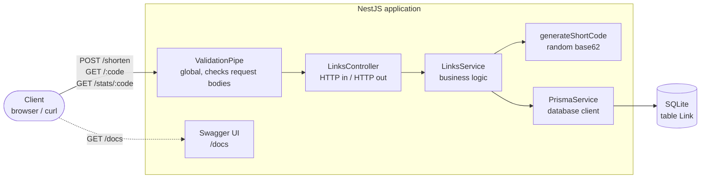
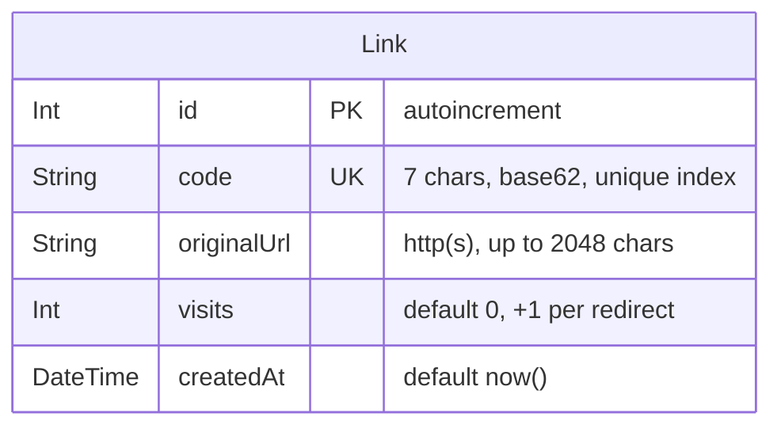
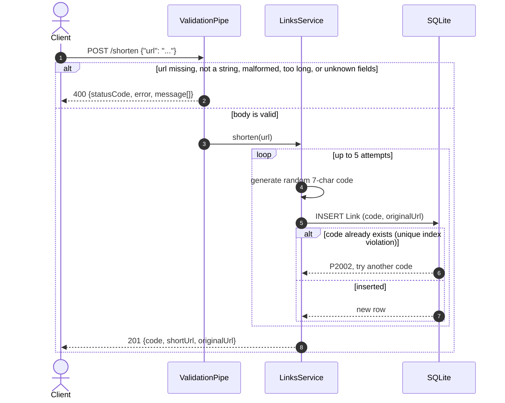
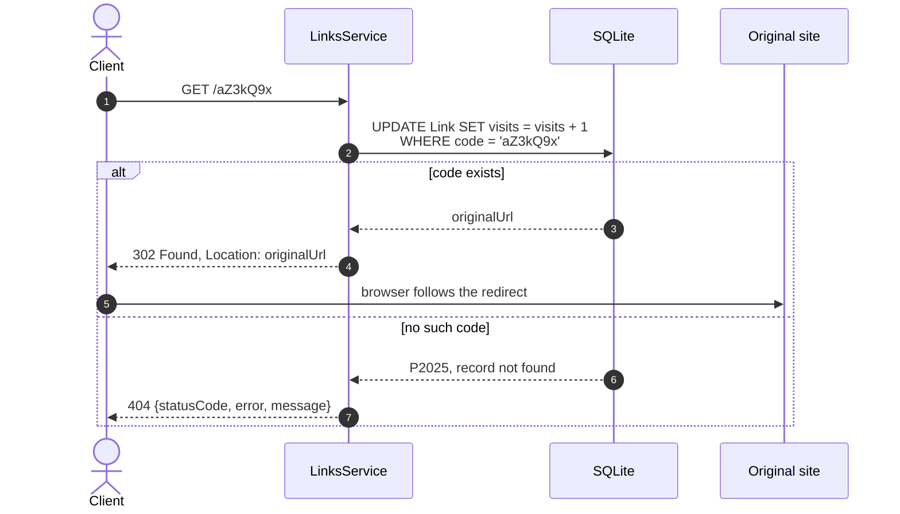
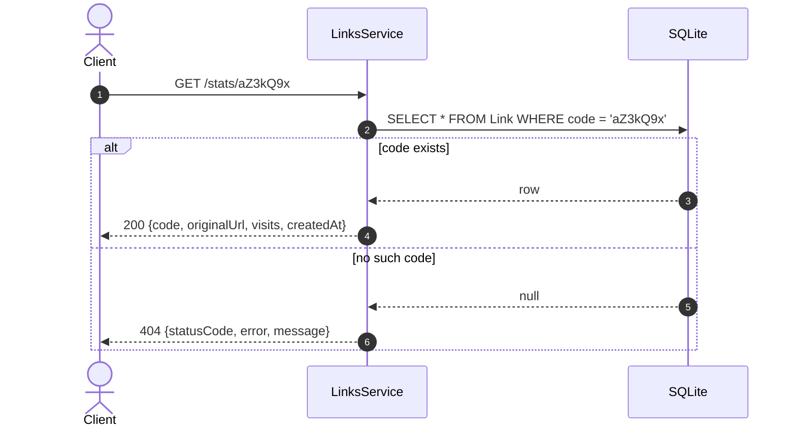
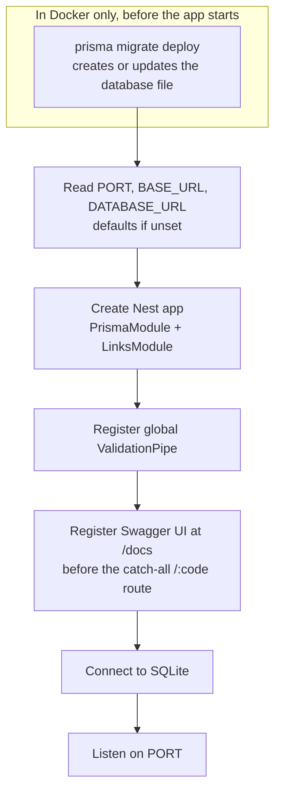

# Architecture

These diagrams are written in [Mermaid](https://mermaid.js.org/). GitHub renders them as images directly in this file; most editors (VS Code with a Mermaid extension, JetBrains IDEs) render them in Markdown preview too.

## Components

How a request travels through the service.

## Data model

## POST /shorten

## GET /:code

The lookup and the visit count are a single atomic statement, so concurrent visits are never lost. The status is 302, not 301, because browsers cache a 301 and would stop hitting the service, which would freeze the counter.

## GET /stats/:code

Reading stats never changes the counter.

## Startup

